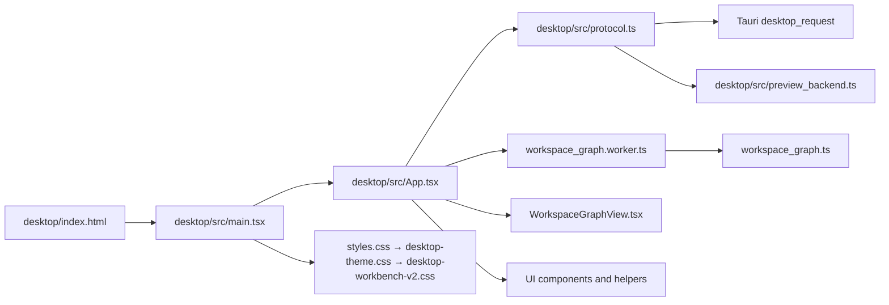
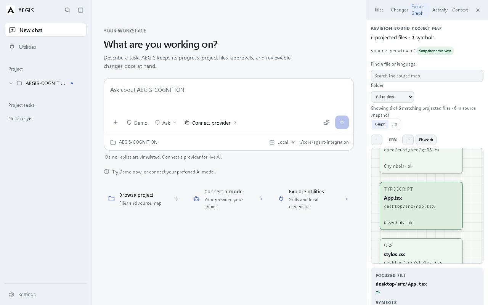
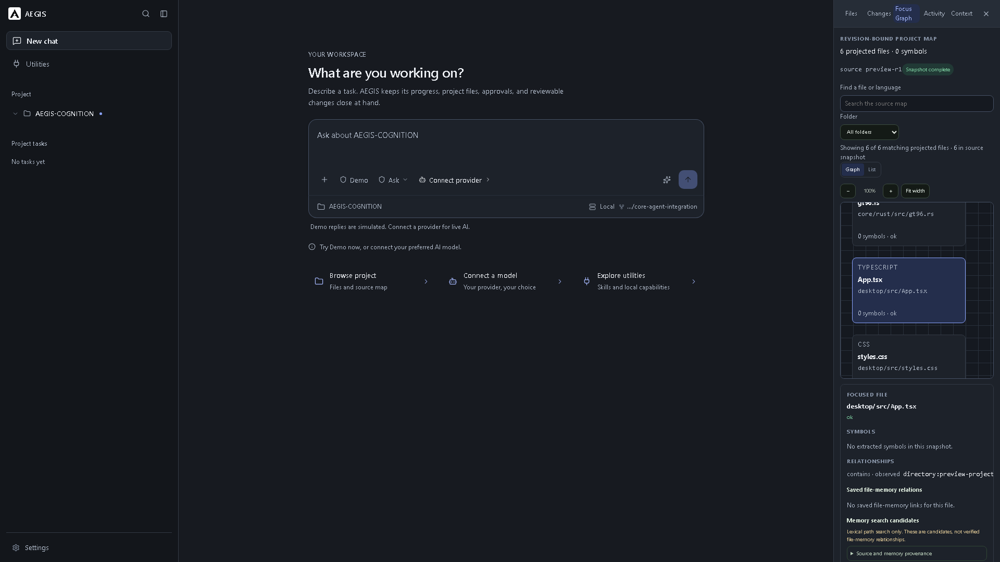
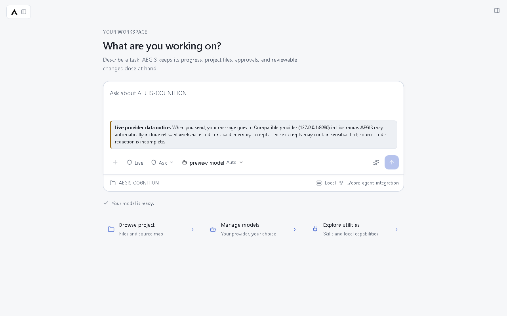

# Bản đồ mã nguồn giao diện desktop

**Ngày kiểm kê:** 2026-10-22

**Phạm vi:** renderer trong `desktop/src/`, điểm khởi chạy HTML/Vite và cấu hình Tauri ảnh hưởng trực tiếp đến cửa sổ giao diện.
**Trạng thái nguồn:** mã được đọc từ working tree tại `HEAD 8962a25`; working tree đang có thay đổi chưa commit, gồm một số tệp giao diện. Nội dung này mô tả snapshot đã kiểm tra, không khẳng định đó là trạng thái đã phát hành.

Tài liệu này là bản đồ trách nhiệm từng tệp và nhận xét tĩnh. [`desktop-workbench.md`](desktop-workbench.md) vẫn là tài liệu mô tả hành vi sản phẩm và bằng chứng giao diện đã ghi nhận. Tài liệu này không thay thế tài liệu đó.

## Luồng tổng thể

`App.tsx` điều phối màn hình và gọi `desktopRequest`. Trong Tauri, `protocol.ts` đóng gói lệnh vào `desktop_request`; ngoài Tauri, cùng lời gọi được chuyển sang adapter xem trước trong bộ nhớ. `App.tsx` cũng gọi trực tiếp một số lệnh Tauri để xin quyền/chọn thư mục và nhập capability. Runtime thật, dữ liệu, quyền truy cập workspace và thao tác provider thuộc host/service; renderer không phải nguồn thẩm quyền.

## Tệp trong `desktop/src/`

### Điều phối và màn hình

| Tệp | Trách nhiệm và liên hệ |
|---|---|
| [`App.tsx`](../../desktop/src/App.tsx) | Root component và bộ điều phối chính (4.886 dòng tại snapshot). Giữ state cho workspace/project, hội thoại, provider/model, task/subagent, work panel, Settings, Utilities, theme và tìm kiếm; tải dữ liệu qua protocol; render sidebar, chat, work panel, Settings và Utilities. Các vùng lớn bắt đầu quanh `renderSidebar` (3630), `renderConversation` (3710), `renderWorkPanel` (4047), `renderSettings` (4191) và `renderExtensions` (4776). Dùng Web Worker để dựng graph. Gọi trực tiếp Tauri cho duyệt/chọn workspace và import, ngoài các lệnh qua protocol. |
| [`AmbiguousToolCallReconciliation.tsx`](../../desktop/src/AmbiguousToolCallReconciliation.tsx) | Thành phần xác nhận hai bước khi kết quả một tool call chưa rõ: chuyển từ nút “I checked the target” sang lời giải thích và lựa chọn giữ unresolved hoặc ghi nhận rằng action chưa xảy ra. Tự đưa focus tới phần giải thích; component không tự kiểm tra hay hoàn tác action bên ngoài. |
| [`ProviderContextDisclosure.tsx`](../../desktop/src/ProviderContextDisclosure.tsx) | Thông báo cạnh composer/setup khi Live provider hoạt động. `providerDestinationHost` chỉ đưa host và port vào nhãn; component không đưa path/query/fragment vào nội dung. Đây là thông báo bằng `role="note"`, không phải bước xác nhận, cổng quyền hay kiểm soát gửi dữ liệu. |
| [`VirtualizedTimeline.tsx`](../../desktop/src/VirtualizedTimeline.tsx) | Hiển thị timeline activity theo cửa sổ ảo; dùng `virtual_window.js`, chiều cao hàng cố định 64 px và danh sách ngữ nghĩa `role="list"`. Thay đổi chiều cao nội dung hàng cần được xem cùng với phép tính cửa sổ và CSS hàng. |
| [`capability-icons.tsx`](../../desktop/src/capability-icons.tsx) | Ánh xạ tên icon dùng trong renderer sang Lucide; icon được đánh dấu trang trí (`aria-hidden`). Tên không có trong map rơi về icon `Circle`. |

### Giao tiếp, kiểu dữ liệu và adapter xem trước

| Tệp | Trách nhiệm và liên hệ |
|---|---|
| [`protocol.ts`](../../desktop/src/protocol.ts) | Contract TypeScript lớn (2.369 dòng): command union, request/response envelopes, DTO cho workspace, conversation, provider, extension/MCP, task, memory và verification; các hàm parse/validate dữ liệu `unknown`; `desktopRequest` chọn transport native hoặc preview rồi giải mã kết quả. Đây là ranh giới quan trọng giữa renderer và host. Khi đổi command/shape, cần rà đồng thời router/service Python/Rust và test contract liên quan. |
| [`preview_backend.ts`](../../desktop/src/preview_backend.ts) | Adapter xem trước trong bộ nhớ cho màn hình chạy ngoài Tauri: conversation, connection/model giả lập, task/subagent, source snapshot và catalog rỗng. Preview không lưu bền, không kiểm tra API key và không gọi provider thật; các thao tác phụ thuộc host như resolve approval hoặc tạo quan hệ memory không được giả làm thành công. |
| [`workspace_graph.ts`](../../desktop/src/workspace_graph.ts) | Dựng projection graph thuần từ `SourceSnapshot`, tạo node project/directory/file và các cạnh `contains` hoặc candidate; giới hạn mặc định 600 file. Cũng chứa định danh và phép kiểm tra độ mới của source/candidate/saved relation. |
| [`workspace_graph.worker.ts`](../../desktop/src/workspace_graph.worker.ts) | Worker nhận `SourceSnapshot`, gọi `buildWorkspaceGraph`, trả graph hoặc lỗi tổng quát; `App.tsx` tạo và kết thúc worker trong quá trình tải graph. |
| [`WorkspaceGraphView.tsx`](../../desktop/src/WorkspaceGraphView.tsx) | View graph/project map (965 dòng): giới hạn canvas 180 node, bố cục tối đa bốn cột, zoom 75–150%, pan bằng phím mũi tên, lọc folder/text, chuyển Graph/List, chọn file và inspector. Inspector phân biệt memory search candidates với saved file-memory relations; relation list phân trang và ẩn kết quả khi nguồn đã đổi. Có nhãn/role cho canvas, list, trạng thái và thao tác. |

### Helper JavaScript và declaration TypeScript

| Tệp | Trách nhiệm và liên hệ |
|---|---|
| [`clipboard_images.js`](../../desktop/src/clipboard_images.js) / [`clipboard_images.d.ts`](../../desktop/src/clipboard_images.d.ts) | Lọc file ảnh từ `DataTransfer.files`, rồi fallback sang `DataTransfer.items`; declaration mô tả kiểu đầu vào/đầu ra cho `App.tsx`. |
| [`command_registry.js`](../../desktop/src/command_registry.js) / [`command_registry.d.ts`](../../desktop/src/command_registry.d.ts) | Nguồn định nghĩa nhãn và phím tắt workbench; resolver phân biệt phím modifier theo nền tảng và trả command ID hoặc `null`. `App.tsx` thực thi các ID đã phân giải. |
| [`mcp_registry_selection.js`](../../desktop/src/mcp_registry_selection.js) / [`mcp_registry_selection.d.ts`](../../desktop/src/mcp_registry_selection.d.ts) | Tạo lựa chọn cấu hình từ metadata MCP nhưng không tự chọn thay người dùng; lọc transport hỗ trợ, so khớp key lựa chọn chính xác, kiểm tra tên biến môi trường bắt buộc và chỉ trả hash tool read-only đã được chọn tường minh. |
| [`mcp_setup_suggestions.js`](../../desktop/src/mcp_setup_suggestions.js) / [`mcp_setup_suggestions.d.ts`](../../desktop/src/mcp_setup_suggestions.d.ts) | Parse và giới hạn gợi ý cấu hình đi kèm extension pack trước khi đưa vào form draft. Kiểm tra ID, kích thước, command/cwd và yêu cầu URL remote HTTPS không có credential/query/fragment, hostname khớp `allowed_host`; không chạy command hoặc kết nối endpoint. |
| [`model_selection.js`](../../desktop/src/model_selection.js) / [`model_selection.d.ts`](../../desktop/src/model_selection.d.ts) | Tìm model bằng cặp `connection_id` + `model_id`, tránh chọn trùng ID model giữa các connection. |
| [`task_state.js`](../../desktop/src/task_state.js) / [`task_state.d.ts`](../../desktop/src/task_state.d.ts) | Gom status run, approval, execution và assistant turn thành trạng thái dùng cho UI; có helper xác định run đang hoạt động, xử lý `RUN_NOT_FOUND`, điều kiện drain queue và nhãn hiển thị. |
| [`virtual_window.js`](../../desktop/src/virtual_window.js) / [`virtual_window.d.ts`](../../desktop/src/virtual_window.d.ts) | Tính khoảng hàng cần render, overscan và tổng chiều cao từ số hàng, vị trí cuộn, viewport và chiều cao hàng. Được `VirtualizedTimeline.tsx` dùng. |
| [`vite-env.d.ts`](../../desktop/src/vite-env.d.ts) | Nạp type declarations của Vite cho renderer. |

### Style và tài sản

| Tệp | Trách nhiệm và liên hệ |
|---|---|
| [`styles.css`](../../desktop/src/styles.css) | CSS nền và nhiều component legacy/source map: layout, chat, work panel, Settings, graph, memory inspector, breakpoint cơ bản. Có quy tắc `body min-width: 960px` ban đầu; stylesheet theme được nạp sau đặt `min-width: 0`, và các breakpoint tiếp tục thay đổi layout. |
| [`desktop-theme.css`](../../desktop/src/desktop-theme.css) | Stylesheet lớn nhất (7.328 dòng): token sáng/tối, scale giao diện, shell, sidebar/chat/composer, Settings/Utilities/work panel, graph overrides, responsive và reduced motion. Do nạp sau `styles.css`, selector trùng tên có thể đổi kết quả theo cascade/import order. |
| [`desktop-workbench-v2.css`](../../desktop/src/desktop-workbench-v2.css) | Lớp style bổ sung cho queue, task state, command palette, source/diff panel, activity timeline và Graph/List. Có media query hẹp và `forced-colors`; một số selector gắn với cờ `data-workbench-v2`. |
| [`main.tsx`](../../desktop/src/main.tsx) | Tạo React root trong `StrictMode`, mount `App`, rồi import CSS theo thứ tự `styles.css` → `desktop-theme.css` → `desktop-workbench-v2.css`. Thứ tự này là một phần của hành vi giao diện hiện tại. |
| [`assets/aegis-icon.svg`](../../desktop/src/assets/aegis-icon.svg) | Tài sản logo dùng trong renderer; README desktop cũng mô tả asset này là nguồn dùng cho bộ icon Tauri. |

## Điểm vào và cấu hình liên quan

| Tệp | Ý nghĩa với giao diện |
|---|---|
| [`desktop/index.html`](../../desktop/index.html) | Tạo `#root`, đặt viewport và `lang="en"`, nạp `/src/main.tsx`; title là `AEGIS`. |
| [`desktop/package.json`](../../desktop/package.json) | Khai báo React 19, Tauri API 2, Vite 8, TypeScript 7, Vitest/Playwright và lệnh build/test. Tài liệu này không chạy các lệnh đó. |
| [`desktop/vite.config.ts`](../../desktop/vite.config.ts) | Vite dùng React plugin, bind `127.0.0.1:1420`, bật `strictPort`; đây là renderer dev server được Tauri tham chiếu. |
| [`desktop/tsconfig.json`](../../desktop/tsconfig.json) | Bật TypeScript strict, `noEmit`, module resolution kiểu Bundler và JSX React. |
| [`desktop/src-tauri/tauri.conf.json`](../../desktop/src-tauri/tauri.conf.json) | Cửa sổ native mặc định 1280×800, tối thiểu 640×480, có native decorations. CSP giới hạn `connect-src` vào IPC; cho phép ảnh `data:`/`blob:` và inline style. |
| [`desktop/src-tauri/capabilities/default.json`](../../desktop/src-tauri/capabilities/default.json) | Capability mặc định gắn cửa sổ `main` với `core:default`; host command bổ sung được đăng ký phía native, không phải quyền tự cấp bởi React. |

## Các vùng giao diện và luồng tương tác

### Chat và điều hướng

- Sidebar điều hướng Home/Utilities, project hiện tại, danh sách task/conversation, Settings; có trạng thái thu gọn, menu project/session và resize.
- Chat có home state, transcript, trạng thái task, composer, gợi ý slash/file, paste/đính kèm ảnh, chọn model và provider notice.
- Task queue, run/cancel, approval và kết quả tool-call chưa rõ được nối với helper trạng thái và command protocol. `App.tsx` vẫn là nơi điều phối các luồng này.
- Command palette và global search dẫn tới conversation, file, destination hoặc Settings. Resolver phím tắt nằm riêng trong `command_registry.js`.

### Work panel

`WorkTab` trong `App.tsx` gồm **Files**, **Changes**, **Map**, **Activity** và **Context**. Files đọc nội dung theo đường dẫn tương đối; Changes đọc danh sách diff và diff của tệp đã chọn; Map dùng source snapshot và graph projection; Activity hiển thị timeline; Context trình bày inspection về context/prompt. Work panel có thể đóng/mở, resize hoặc chuyển thành overlay theo chiều rộng.

### Settings và Utilities

Settings có 13 mục, nhóm theo Preferences (**General**, **AI**, **Shortcuts**), Agent (**Instructions**, **Models**, **Skills**, **MCP**, **Plugins**, **Subagents**), Workspace (**Import**, **Projects**) và System (**Remote Hosts**, **Info**). `renderSettings` định nghĩa nhóm, search aliases và nội dung từng mục trong `App.tsx`.

Utilities tổng hợp trạng thái capability cục bộ (source map, memory, conversations, provider, subagents, skill, extension và MCP), cho phép tìm kiếm, xem chi tiết và chuyển sang đúng mục thiết lập. Import chỉ tạo draft/metadata và yêu cầu review/approval trước khi kích hoạt; chi tiết thực thi do host quản lý.

### Theme, kích thước và accessibility trong source

- `desktop-theme.css` định nghĩa token light/dark và bốn mức font/UI scale; `App.tsx` lưu theme/preset trong state và đồng bộ với settings.
- Source có breakpoint cho cửa sổ hẹp, work panel overlay, focus-visible, một số vùng keyboard navigation, `prefers-reduced-motion` và `forced-colors`.
- Graph view cung cấp canvas điều khiển bằng phím và lựa chọn List có cấu trúc danh sách; status/error có `role="status"` hoặc `role="alert"` tại các vùng liên quan.
- Đây là bằng chứng về markup/CSS/handlers trong source, không thay cho kiểm tra render, contrast đo được, keyboard-only đầy đủ hoặc screen reader.

## Ảnh giao diện minh họa

Các hình dưới đây là bản sao của ảnh browser evidence đã lưu trước đó, không phải ảnh chụp mới trong lượt kiểm kê này. Hai ảnh Focus Graph được chụp ngày 2026-10-22 trên Chromium 153.0.8010.12, route `/`, với reduced motion; file đang chọn là `desktop/src/App.tsx`. Snapshot preview có 6 file và 0 symbol, nên chỉ minh họa bố cục và trạng thái hiển thị, không chứng minh quan hệ memory thật hay hành vi native. Chi tiết run và giới hạn được ghi trong [`desktop-workbench.md`](desktop-workbench.md).

*Hình 1. Focus Graph ở light theme, 1280×800. Phần “Memory search candidates” nằm dưới vùng nhìn ban đầu; evidence ghi nhận người dùng có thể cuộn work panel để tới phần này.*

*Hình 2. Cùng luồng chọn file ở dark theme, 1920×1080. Inspector hiển thị rằng không có saved file-memory link và các kết quả tìm kiếm chỉ là candidate, chưa xác minh.*

Ảnh provider notice dưới đây là browser evidence từ 2026-10-16 ở 1280×800 light theme, dùng local deterministic preview. Đây là thông báo cạnh composer về code workspace và trích đoạn memory có thể được gửi tới provider; ảnh không chứng minh đã gọi provider thật.

*Hình 3. Notice nêu đích provider, khả năng tự động kèm code/excerpt và giới hạn redaction. Đây là thông tin hiển thị, không phải bước xác nhận hoặc cổng chặn gửi.*

## Nhận xét review tĩnh

Các ghi chú sau dựa trên source của working tree; chưa chạy browser, Tauri window hoặc screen reader trong lượt này.

### 1. Tập trung trách nhiệm ở `App.tsx` — P2, rủi ro bảo trì

- **Điều kiện:** thêm hoặc sửa tính năng chạm đồng thời conversation, workspace, provider, settings hay utilities.
- **Quan sát:** cùng một component giữ state và luồng async cho nhiều miền, đồng thời dựng hầu hết màn hình; file có 4.886 dòng tại snapshot.
- **Tác động:** thay đổi ở một miền có thể làm tăng phạm vi review và tương tác state ngoài dự kiến. Đây là rủi ro maintainability suy ra từ cấu trúc, chưa phải lỗi runtime đã tái hiện.
- **Bằng chứng:** [`App.tsx`](../../desktop/src/App.tsx#L630) bắt đầu root component; các handler/lifecycle trải từ bootstrap và workspace đến provider/MCP, conversation/task và các hàm render được dẫn ở bảng trên.
- **Hướng xử lý:** khi có thay đổi tiếp theo, tách dần theo owner đã có (workspace lifecycle, provider/MCP setup, conversation/task, Settings/Utilities), giữ protocol và quyền host làm boundary. Không cần rewrite để hoàn thành kiểm kê này.

### 2. Ngôn ngữ UI không nhất quán — P3, accessibility/localization

- **Điều kiện:** screen reader đọc các thông báo tiếng Việt trong renderer.
- **Quan sát:** tài liệu HTML khai báo `lang="en"`, trong khi một số status/notice trong `App.tsx` là tiếng Việt.
- **Tác động:** bộ đọc màn hình có thể áp dụng cách phát âm tiếng Anh cho chuỗi tiếng Việt; copy cũng không có một locale nhất quán.
- **Bằng chứng:** [`index.html`](../../desktop/index.html#L2); chuỗi ví dụ tại [`App.tsx`](../../desktop/src/App.tsx#L1725), [#L2440](../../desktop/src/App.tsx#L2440) và [#L2444](../../desktop/src/App.tsx#L2444).
- **Hướng xử lý:** chọn locale UI làm mặc định hoặc gắn `lang` chính xác cho vùng/chuỗi được bản địa hóa. Screen-reader behavior chưa được kiểm chứng trong lượt này.

### 3. Ownership của CSS phụ thuộc cascade — P3, rủi ro regression

- **Điều kiện:** chỉnh selector dùng chung giữa nền, theme và Workbench V2.
- **Quan sát:** ba stylesheet được import tuần tự; `styles.css` và `desktop-theme.css` đều định nghĩa style cho shell/work panel/graph; theme file có 7.328 dòng và thêm các override về sau.
- **Tác động:** sửa đúng selector ở một file có thể bị rule muộn hơn ghi đè, làm khó xác định nơi cần đổi và tăng nguy cơ lệch giữa theme/viewport.
- **Bằng chứng:** [`main.tsx`](../../desktop/src/main.tsx#L4), [`styles.css`](../../desktop/src/styles.css#L82), [`desktop-theme.css`](../../desktop/src/desktop-theme.css#L99) và graph/work-panel rules gần cuối theme file.
- **Hướng xử lý:** giữ một owner rõ cho token và từng vùng component khi đụng tới CSS; loại bỏ override chỉ sau khi có bằng chứng render cho route/theme/viewport liên quan. Chưa có lỗi hình ảnh nào được xác nhận ở đây.

### Ghi chú về ranh giới dữ liệu

`ProviderContextDisclosure` chỉ giải thích dữ liệu có thể được gửi tới host provider. Nó không hỏi người dùng trước từng lần gửi và không thay đổi payload/authorization. `preview_backend.ts` là dữ liệu mô phỏng trong bộ nhớ, vì vậy không dùng kết quả preview để kết luận về provider live, quyền native hoặc lưu bền. Các ranh giới này nên được giữ rõ trong copy và khi thêm luồng UI mới.

## Bằng chứng đã có và giới hạn của lượt kiểm kê

- Danh sách renderer được đối chiếu bằng cách liệt kê toàn bộ tệp dưới `desktop/src/` (30 tệp); các tệp entry/config ảnh hưởng cửa sổ được đọc bổ sung.
- Các suite liên quan hiện có gồm `desktop/test/workbench-core.test.mjs`, `desktop/test/protocol-inspection.test.ts`, `desktop/test/workspace_graph.test.tsx`, `desktop/test/ambiguous-tool-call-reconciliation.test.tsx`, và các E2E dưới `desktop/test/e2e/`.
- **Không chạy test/build** trong lượt này; yêu cầu là kiểm kê và nhận xét tài liệu, không yêu cầu xác minh triển khai. Vì thế không đưa ra kết luận pass/fail mới.
- **NOT VERIFIED:** giao diện render hiện tại, mọi viewport/theme ở Tauri, focus thực tế khi dùng bàn phím, screen reader/native accessibility, live provider và tính nhất quán giữa protocol renderer với runtime đang chạy. Tham khảo các bằng chứng/giới hạn đã ghi trong [`desktop-workbench.md`](desktop-workbench.md).

## Đường dẫn đọc tiếp

- [Hành vi giao diện và bằng chứng đã ghi](desktop-workbench.md)
- [README desktop và ranh giới host/service](../../desktop/README.md)
- [Protocol TypeScript của renderer](../../desktop/src/protocol.ts)
- [Thiết kế và kế hoạch project map](../architecture/personal-code-map-implementation-plan.md)
